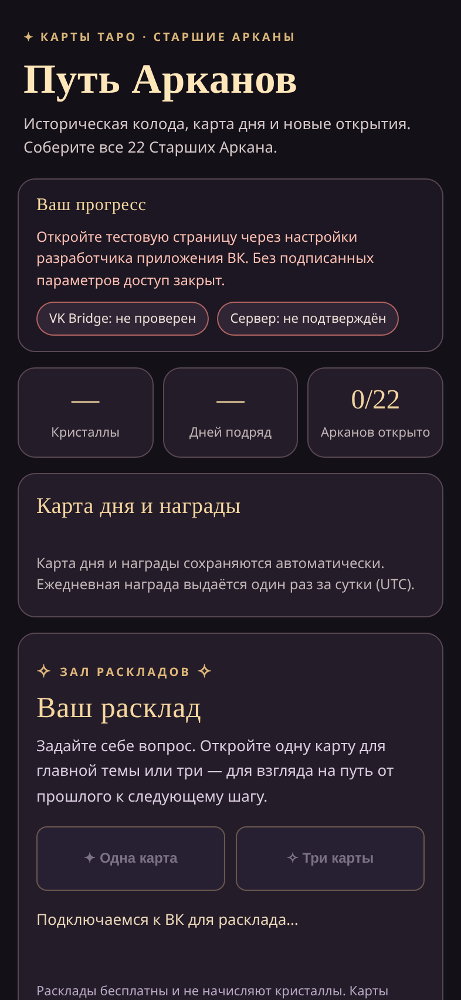
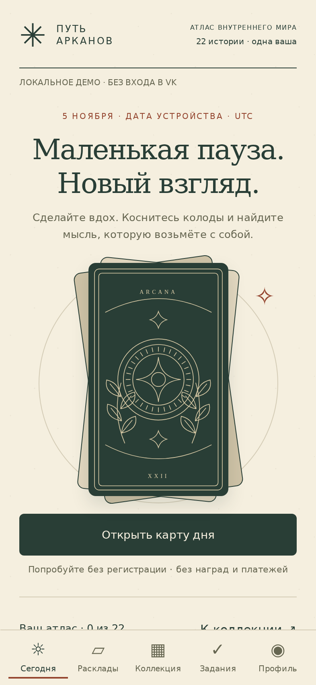

# Путь Арканов V6 — implementation and observed QA

Date: 2026-11-05. Issue #1; draft PR #2. Work is confined to
`feature/tarot-v6-cookie-inspired-20261105`, based on the isolated V5 stage.

## Play the implementation

- Anonymous showcase: https://put-arkanov-v6-demo-20261105.maksimiirina1992.chatgpt.site/index.html
- Source app with optional signed VK flow: `/v6/index.html` on a separately
  configured backend preview. Existing `/release/index.html` and `/` routing are unchanged.
- `npm run build:v6` produces `v6/dist/`, an anonymous-only, portable static
  build. Even a syntactically signed URL cannot activate its API client.
- Hosting is a new, separate Sites project, with no connectors, API, keys,
  databases, advertisements, payments or production game configuration.

The public demo is playable without VK. It is not an authenticated production
game. No real Neon credentials or VK key were accessed, copied or changed.

## Delivered behavior

| Area | Behavior |
| --- | --- |
| Today | Original illustrated deck, tactile flip, stable daily card, topic-specific reflection, save/share only on user action |
| Readings | Four themes, 1/3 distinct cards, individual reveals, original interpretations and questions, downloadable complete result |
| Collection | 22 original local SVG engravings, unknown/unlocked states, accessible modal details, chapter milestones at 5/10/22 cards |
| Quests | Daily reveal and three achievable reflection tasks; explicit session/local status, no client-issued rewards |
| Profile | Local or server progress/streak, optional VK name request, motion setting, saved thoughts, help, rights/provenance, local reset and signed deletion request |
| Returning visits | Local demo stores daily openings/collection and up to 30 thoughts; deterministic UTC day loop; authenticated state comes from PostgreSQL |
| Offline | Explicit static cache allowlist; demo works after first complete cache installation; storage denial and art failure have readable fallbacks |

The anonymous loop intentionally awards no currency. Signed daily rewards remain
under the existing server flags, transaction locks and unique daily constraints.
Spreads do not affect account balances or unlock the collection. The signed
client persists no launch parameters, VK identity or server progress in browser
storage. Its saved thoughts remain in session memory, with an explicit download.

## Design and provenance

Warm paper `#f5efdf`, ink `#293e36`, terracotta `#94452f`, engraved botanical and
celestial motifs, local DejaVu Serif/Sans, native touch/keyboard buttons, visible
focus and reduced-motion support. Five bottom navigation areas have safe-area
padding. Layouts cover 320/360/393/430 px and 2x/1.25x pixel ratios.

All 22 illustrations, card back, paper texture and 88 thematic questions are
original project work. Sources are `scripts/v6-art.mjs` and
`scripts/v6-content.mjs`. V5's historical scan URLs are not used by V6.
`v6/LICENSES.txt` and adjacent full license texts document provenance.

Official `@vkontakte/vk-bridge@2.14.0` is pinned with npm integrity and vendored
byte-for-byte; the build checks it against the installed official package. No
third-party script, font or image origin is on V6's startup path. The CSP allows
only same-origin resources. The full static directory is approximately 412 KiB
before transport compression.

Research actually read: official VK Bridge and create-vk-mini-app READMEs,
https://lunagames.ru/pechenka/ and https://t-j.ru/vk-cookie-story/ . Only the broad
daily-ritual/collection/return-visit concept informed this work. The official
`dev.vk.com/ru/mini-apps/bridge` URL failed from this environment; current VK
permissions, domain allowlist and policy compliance have not been certified.

## Observed checks

| Check | Result |
| --- | --- |
| `node --check` across server, API, V6 and build scripts | PASS |
| All Node tests against two fresh PostgreSQL 16 databases | **50 passed, 0 failed, 0 skipped** |
| V6 Playwright: 12 scenarios × four Android viewport configurations | **48 passed** |
| Existing V5 signed UI regression: three scenarios × three widths | **9 passed** |
| axe WCAG 2 A/AA and 2.1 AA across five screens × four widths | No violations in tested states |
| Visible button height / horizontal overflow | All tested buttons at least 44px; no overflow |
| Unsigned first load | Zero API and external-origin page requests |
| Offline reload and readings | PASS after real service-worker cache installation |
| Forged, expired, missing and duplicate launch parameters | Rejected or local-only; no unauthorized writes |
| Signed PostgreSQL claim/draw/relaunch | PASS; one reward, same daily card, restored collection |
| Privacy request | Signed, idempotent, no account creation/deletion, no reward flag change |

Evidence: [Node/Postgres log](qa/v6/node-postgres.txt),
[V6 browser log](qa/v6/playwright-v6.txt),
[V5 regression log](qa/v6/playwright-v5-regression.txt).
All identities and HMAC keys in the test harness are synthetic fixtures; no
real signed launch was used. Authentication traces are disabled.

The first browser run found test synchronization/cache-interception mistakes;
these were corrected before the successful full matrix. A repeat of an existing
V5 test on reused fixture databases found its fixed-ID state from the previous
run. The clean-database run passed; CI provisions fresh databases.

### Before/after and game screens

| V5 unsigned dead end | V6 first session |
| --- | --- |
|  |  |

Additional actual-browser screenshots: [320px](qa/v6/today-320.png),
[360px](qa/v6/today-360.png), [430px, DPR 1.25](qa/v6/today-430.png),
[daily reveal](qa/v6/reveal-393.png), [reading](qa/v6/readings-393.png),
[collection](qa/v6/collection-393.png), [quests](qa/v6/quests-393.png),
[profile](qa/v6/profile-393.png), [hosted demo](qa/v6/hosted-demo-393.png).
These are Chromium mobile emulation, not physical Android/VK screenshots.

## Reproduce locally or in CI

Use Node 24 and two **fresh disposable** PostgreSQL databases. Never supply live
database URLs to tests. `PGTEST_URL` and `PGTEST_V5_URL` must be distinct.

```sh
npm ci --ignore-scripts --no-audit --no-fund
npm run build:v6
# Set PGTEST_URL and PGTEST_V5_URL to disposable loopback databases.
npm test
npm --prefix tests ci --ignore-scripts --no-audit --no-fund
cd tests
npx playwright install chromium
```

Serve the repository on `127.0.0.1:8765`. The guarded
`server/test/pg-http-fixture.mjs` uses loopback `8788`, `NODE_ENV=test`, a
synthetic VK key, the two fixture URLs and test-only reward flags. Exact setup
is encoded in `.github/workflows/tarot-v6.yml`. Then run `npm run test:v6` from
the root. The workflow also runs the existing V5 browser suite and retains
separate reports, screenshots and the anonymous static build for 14 days.

## Privacy queue migration and rollback

`POST /api/v2/privacy/deletion-request` accepts no body or query. It verifies
the existing VK HMAC/freshness and same-origin policy, requires the dedicated
public-game database and a directly configured protected key, and cannot fall
back to the developer database or delegated V4 verifier for the write.

It lazily creates `tarot_v6_deletion_requests(user_id PRIMARY KEY,
requested_at TIMESTAMPTZ)` and inserts a pending request with `ON CONFLICT DO
NOTHING`. A transaction advisory lock serializes the additive migration.
Requests return only `{status:"pending"}`. It does not alter existing game
tables, create an account, delete records, or enable rewards. No live migration
was run. Automated tests use two actual isolated databases.

Rollback: stop serving the new frontend/route and keep the queue table for
operator processing. No destructive down migration is required. Do not drop
pending privacy requests or game data as part of rollback. Human processing,
operator contact and a retention policy remain release conditions.

## Remaining release conditions — not declared production-ready

- GitHub Actions results and external-network observations are recorded in the
  PR after completion; local green tests alone are not a CI result.
- Physical Android/VK WebView, current app-domain allowlist, real signed launch,
  optional VK name/share dialogs and device safe-area behavior need owner UAT.
- The anonymous host's success from this execution environment is not proof of
  reachability from every Russian ISP or the owner's handset. A first visit
  with no network/DNS cannot be fixed by a service worker not yet installed.
- Authenticated V6 deployment needs its **own isolated** Neon database assigned
  to `TARO_V5_DATABASE_URL` in a new backend preview. No live V5/V4 database was
  reused or reconfigured in this task. Real signed hosted progression remains
  unverified; synthetic local PostgreSQL progression is verified.
- `TARO_V2_WRITES_ENABLED=false` and `TARO_V5_PUBLIC_RELEASE_CONFIRMED=false`
  remain required on live staging. Existing public launch URL, main, V4, V5
  stage, reward/payment/ad settings, secrets and billing were not changed.
- Operator identity/contact, consent, retention, deletion-request processing,
  cross-border data rules, VK moderation and legal review remain incomplete.
- No merge, public VK release, production game reward activation or paid
  service was performed. The isolated anonymous static demo is the only new
  public publication.

Single device UAT: open the demo URL on Android in the intended network,
reveal today's card, open and complete a three-card reading, then report whether
the address and all three cards loaded. A separate authorized signed VK launch
is needed before approving the authenticated game.
